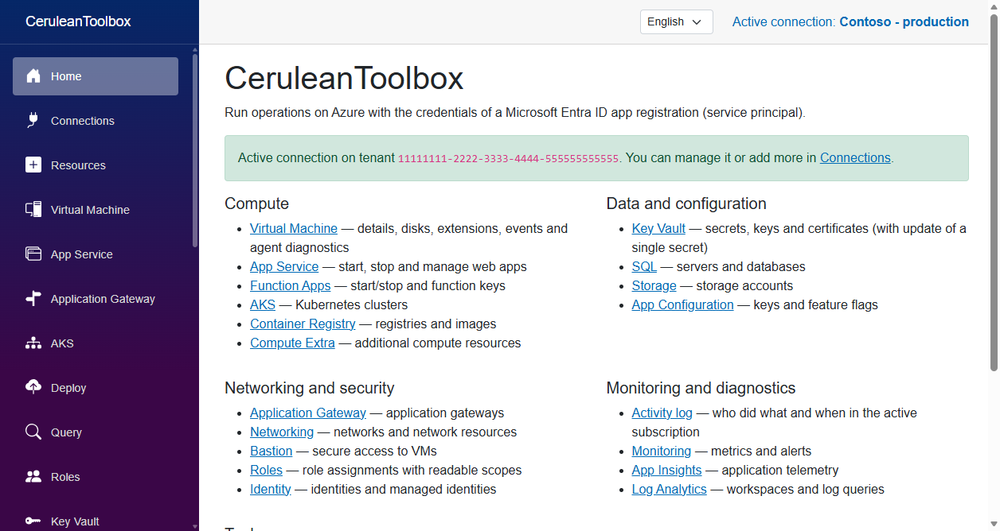
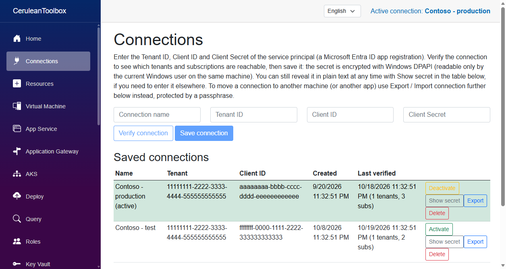
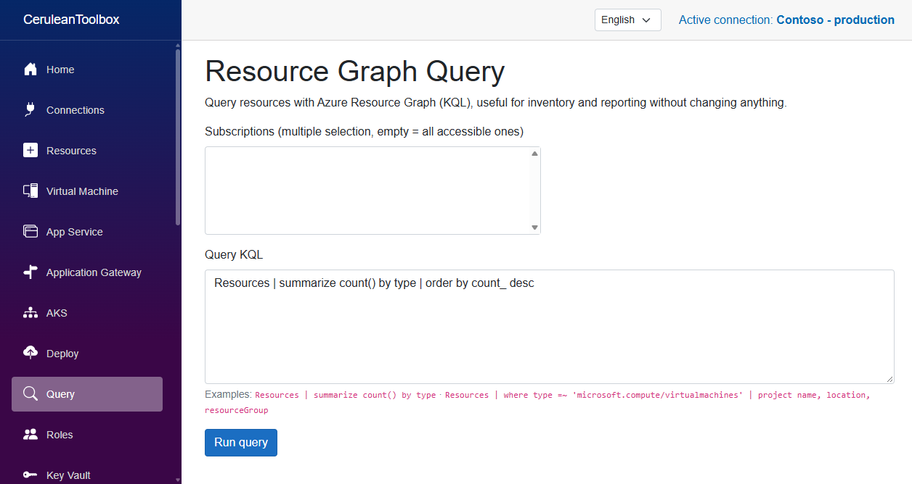
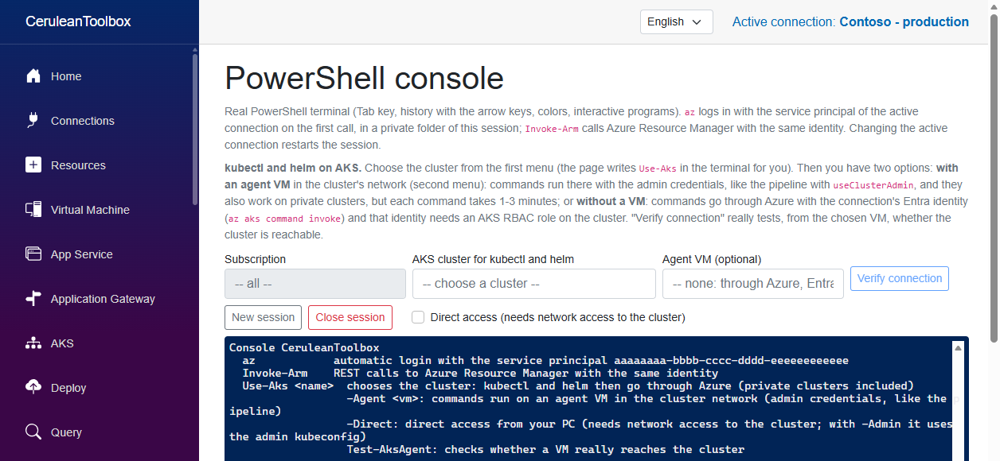

# CeruleanToolbox

*A toolbox for Microsoft Azure.*

[Italiano](README.it.md)

A local web app (.NET 8 Blazor Server) to run operations on Azure with the
credentials of a Microsoft Entra ID **App Registration** (a service principal:
Tenant ID, Client ID, Client Secret).

CeruleanToolbox is an independent open-source project. It is not affiliated with, endorsed by or sponsored by Microsoft. Microsoft, Azure, Microsoft Entra and Azure DevOps are trademarks of the Microsoft group of companies.

This repository holds **CeruleanToolbox** and the library it uses, `src/Toolbox.Core`:

- **CeruleanToolbox** (`src/CeruleanToolbox`, web, and `src/CeruleanToolbox.Desktop`, Windows desktop): pages for most Azure resource types.
- **Toolbox.Core** (`src/Toolbox.Core`): the shared library (saved connections, Azure clients, VM diagnostics).

The user interface is available in **English** and **Italian**. Pick the language in the selector at the top of the page; the first run uses the language of Windows. The code and the documentation are in English; the Italian texts live in `Locales/it.json` in each project.

**Translating:** every text in the code is written in English as `T("Text")` (or `T("Loaded {0} items", count)`), and `Locales/<code>.json` maps the English text to its translation. A text with no entry shows in English, so a translation can be partial. To add a language, add its code and name to `Tr.Languages` (`src/Toolbox.Core/Localization/Tr.cs`) and a `<code>.json` file in each project's `Locales` folder. Pull requests with new languages or corrections are welcome. The Italian files were checked by comparing every page of the previous Italian-only build with the new one.

## Screenshots

The screenshots use a made-up connection ("Contoso") and show the pages before any subscription is chosen, so they contain no real tenant, subscription or resource.



*Home: the sections of the app, the language selector and the active connection.*



*Connections: verify and save service principals, activate or deactivate one, show its secret, export it.*



*Query: Azure Resource Graph (KQL) over the subscriptions the connection can reach.*



*PowerShell console: a real terminal signed in with the active service principal, with `kubectl` and `helm` helpers for AKS.*

## Project status

The project is at an early stage and has been tested only by its author. Development and checks were almost always read-only or on sandbox resources. This is what is not finished:

- **10 delete/revoke actions are switched off** and have never been tried on real resources. The real code is there, but it sits under a `DEBUG-TEST` block that prints a message and does nothing else. Find them with `grep -rn "DEBUG-TEST" src`:
  - App Configuration: setting (`DeleteSettingAsync`)
  - Bastion: shareable link (`DeleteShareableLinkAsync`)
  - Compute Extra: managed disk and snapshot (`DeleteManagedDiskAsync`, `DeleteSnapshotAsync`)
  - Container Registry: tag and repository (`DeleteTagAsync`, `DeleteRepositoryAsync`)
  - Key Vault: certificate (`DeleteCertificateAsync`)
  - Networking: NSG rule (`DeleteNsgRuleAsync`)
  - Roles: role assignment (`DeleteAssignmentAsync`)
  - SQL: firewall rule (`DeleteFirewallRuleAsync`)
- **Partly tried:** the actions that write (start, stop, restart, purge, update of secrets) were checked up to the step before saving. Not all of them have been run to the end on real resources.
- **Not tried yet:**
  - purging the Front Door/CDN cache from the Endpoint table of a profile (the author approved using it, but nobody has confirmed running it from the app);
  - in Key Vault, the lists of secrets, keys, certificates and deleted items, and secret versions, on real data;
  - installing on another PC;
  - behaviour with a service principal that has reduced permissions;
  - the desktop window for the most recent features.

The full list of checks is in [CHECKLIST.md](CHECKLIST.md) (also in [Italian](CHECKLIST.it.md)).

### What has been verified

What **has** been tried, on the author's development environments and a sandbox (checks that write are listed separately):

- **Resource viewing pages** (AKS, Virtual Machine, App Service, Function App, SQL, Storage, Key Vault, Container Registry, App Configuration, Application Gateway): the overviews read real ARM responses, first examined read-only on a real environment; the app also shows them with missing fields or default values.
- **Activity log and VM detail:** verified in the browser on real VMs of a sandbox (disk, extensions with status and error, recent events, who did what). Not opened in the desktop window.
- **VM diagnostics** (Linux and Windows): disk, network towards Azure and last custom script, tried on two real sandbox VMs; it reads and does not modify.
- **PowerShell console:** a real terminal session in the browser and in the desktop window. `kubectl get nodes` and `helm list -A` ran on a development cluster through an agent VM, and the reachability check from the VM worked. The lists of clusters and VMs come from Resource Graph: with a connection that sees 127 subscriptions, 5 clusters took about 2.4 s and 121 VMs about 0.6 s. The author also ran `helm upgrade`, `kubectl apply` and `az aks upgrade` from the console; those runs were reported by the author and not re-checked here.
- **Function App:** the invocation logs show error counts and the last error, and a read error from Application Insights (the `success` column is text) is fixed. On a real app, the status of the Key Vault references showed a denied-access case for a disabled version. The author tried the "Refresh references now" call (the refresh that Microsoft documents). The typed confirmation for Stop and Restart (header and list) was tried up to the confirmation.
- **Key Vault:** for "Update" and the other writes, the interface was tried up to the save (button disabled when empty, cancel), not the real save.
- **Interface:** the solution builds without errors, also from a clean clone, and the web app answers on all pages. The state of every page (selection, filters, loaded lists) is kept when you change menu entry, tried on Query and on the Key Vault filter. The header alignment was checked in the browser.
- **Deleting a saved connection:** tried on a demo store of made-up connections: the typed confirmation stays disabled until the exact name is typed, deleting a connection removes it from the file and from the list, and deleting the active one leaves no connection active. Not tried on a store of real connections.
- **English/Italian interface:** the first screen of each of the 24 pages reads the same text in Italian as the previous Italian-only build (0 different lines) and shows no Italian in English. The language switch works in the web app and in the desktop window, and every `{0}` placeholder of the translations matches its English text. **Not checked:** the views you reach only by choosing a resource or a tab (overviews, tables, status messages, errors) were converted and checked against the code, but not opened one by one in both languages, so some wording there may still need fixing. The texts that the diagnostic scripts print on VMs are translated when the script is sent; no script has run on a VM since the change.

### How you can help

See [CONTRIBUTING.md](CONTRIBUTING.md) for how to build, test safely and send changes, and [SECURITY.md](SECURITY.md) to report a security problem (please do not open a public issue for it).

You are welcome to **try it and tell us what is wrong**, or to contribute:

- Try the actions in a test subscription (not in production to begin with) and open an issue with what you saw, even if everything works: we need to know what has been verified.
- Remove the `DEBUG-TEST` block of one delete action, try it on a throwaway resource and propose the change in a pull request, saying what you tried.
- Report the minimum permissions a page needs, unclear error messages, translations and Azure pages that are missing.

## How authentication works

The app signs in with a normal service principal (`ClientSecretCredential`):

1. Create or reuse an **App Registration** in **Microsoft Entra ID** and generate a **client secret** (Certificates & secrets → New client secret), or take the Tenant ID/Client ID/Client Secret of an existing App Registration.
2. Open **Connections** (`/connections`) in the app, enter Tenant ID, Client ID and Client Secret, press **Verify connection** (it lists the tenants and subscriptions that are actually reachable with these credentials, confirming they are correct) and then **Save connection**.

### Where the credentials are stored

The connection manager (`ConnectionManagerService`) saves the connections in `%LOCALAPPDATA%\CeruleanToolbox\connections.json`. The client secret is encrypted with **Windows DPAPI** (`ProtectedData`, `DataProtectionScope.CurrentUser`), so only a process running under the same Windows account on this machine can read it. Copying the file to another PC, or letting another user read it, does not decrypt the secret. The file stays outside the repository: it is created at run time and not versioned. You can save several connections and activate one at a time from the same page. Every row has a **Show secret** button that shows the saved client secret in clear (for example to enter it in another tool), so do not leave the app open on this page on a machine you do not trust.

### Moving a connection to another machine

The encrypted file is tied to your Windows account and this PC, so copying `connections.json` is not enough. To take a connection with you, use **Export** on its row in **Connections**: the app asks for a passphrase (typed twice) and creates a `.ceruleantoolbox` file encrypted with it (AES-256-GCM, key derived from the passphrase with PBKDF2-SHA256, 200,000 iterations). The web version downloads the file through the browser; the desktop version uses the Windows save dialog.

On the other machine open **Connections**, go to **Import connection**, choose the file and type the passphrase. The Name, Tenant ID, Client ID and Client Secret fields at the top of the page are filled in; then verify and save the connection as usual. Nothing is imported silently.

Keep the file and the passphrase apart, and delete the file when you have finished: anyone who has both can read the client secret.

## Getting started

### Web version (development)

```bash
cd src/CeruleanToolbox
dotnet run
```

By default the app listens on `localhost` only: do not expose it to a network or the Internet without adding authentication, since it holds a service principal with permissions on Azure.

### Desktop version (installable)

`src/CeruleanToolbox.Desktop` is a Windows desktop app (WinForms + [`BlazorWebView`](https://learn.microsoft.com/aspnet/core/blazor/hybrid/)) that hosts the same Razor components **in-process**, through a message channel to the WebView2 control. There is no Kestrel, no HTTP and no port or IP, unlike the web version (which stays Blazor Server). The pages and the services (`Services/*.cs`) are shared 100% between the two projects through `AddCeruleanToolboxServices()` (`src/CeruleanToolbox/CeruleanToolboxServiceCollectionExtensions.cs`). The only real difference is the export/import of connections: the desktop version uses the native Windows dialogs instead of a browser download (see `IConnectionFileDialogService`).

```bash
cd src/CeruleanToolbox.Desktop
dotnet run
```

Or publish a standalone executable:

```bash
cd src/CeruleanToolbox.Desktop
dotnet publish -c Release -r win-x64 --self-contained
```

It needs the [WebView2 Runtime](https://developer.microsoft.com/microsoft-edge/webview2/) (preinstalled on up-to-date Windows 10/11 together with Edge).

### Shared library

- `src/Toolbox.Core`: saved connections, Azure clients, the ARM REST helper and VM diagnostics (`VmDiagnosticsService` + the `VmDiagnosticsPanel` component). It is registered with `AddToolboxCore()`.

The Virtual Machine page shows the general diagnostics (disk, network towards Azure, last custom script). The Connections page is the `ConnectionsView` component of `Toolbox.Core`.

## Features

- **Connections** (`/connections`) — connection manager: enter, verify (reachable tenants/subscriptions) and save encrypted credentials; manage several connections and switch between them (with a confirmation), deactivate or delete one, and export a connection to a passphrase-protected file to import it on another machine.
- **Resources** (`/resources`) — Subscription and Resource Group are both optional. Pick a subscription to see its VMs, App Services, AKS clusters, Application Gateways and the full inventory across **all** resource groups at once (with Subscription and Resource Group columns), or leave it empty to see and filter across all reachable subscriptions. Every table has text-search filters on the distinct values of each column. Actions: start/stop/restart for VMs and App Services, start/stop for AKS and Application Gateway. The "Details" button of a VM shows size, OS, OS disk and data disks (name and size), NICs (private/public IP) and installed extensions (publisher, type, version, provisioning state), and lets you **resize** the VM among the sizes available for that location.
- **Bastion** (`/bastion`) — list of Azure Bastion hosts across the subscription (SKU, DNS name, shareable-link state) and creation of a **Bastion Shareable Link** for a VM: a URL that opens an RDP/SSH session in the browser without going through the Azure portal, useful for someone who only has read access on the VM. It needs a Standard Bastion host with the shareable link enabled. Creating the link calls the Azure REST endpoint directly (the installed .NET SDK does not expose it yet, only read/revoke), while the revoke uses the SDK.
- **Log Analytics** (`/loganalytics`) — lists the Log Analytics workspaces across the subscription (retention, SKU, Workspace ID behind a Show/Hide toggle) and runs free KQL queries on the infrastructure and platform logs collected there (`AzureActivity`, `Heartbeat`, `Perf`, `Syslog`/`Event`, diagnostic settings of other resources connected to the workspace). It complements App Insights, which covers application telemetry, and has the same limits: a 60 s query timeout and results cut to 200 rows. It also lists the **legacy Solutions** (`Microsoft.OperationsManagement/solutions`, e.g. Update Management, Security & Audit) that predate the unified Azure Monitor experience.
- **Automation** (`/automation`) — lists the runbooks of an Automation Account (type, state, number of jobs), starts a job with optional parameters (`key=value`, one pair per line) and shows the history of recent jobs with state, error detail and creation/start/end timestamps.
- **Container Registry** (`/containerregistry`) — lists the registries (SKU, login server, Admin User state), reads and regenerates the admin credentials, and browses the repositories and tags of the published images. A single tag or a whole repository can be **deleted**, behind a typed confirmation: the most common use is cleaning up old images. The page also shows the state of the configured geo-replications. Reading and deleting use the ACR REST APIs (`/v2/...` for reading, the `/acr/v1/...` extension for deletion), which the ARM SDK does not cover because it only manages the registry resource. They authenticate with the admin credentials: if the Admin User is disabled, the page offers to enable it with one click. The AAD→ACR token exchange for RBAC access without admin credentials is not implemented.
- **App Configuration** (`/appconfiguration`) — list of App Configuration stores, reading all key/value pairs (with label), creating/updating a key and deleting. It needs an explicit data role on the store (**App Configuration Data Owner** to write, **Data Reader** for read only) — the same RBAC exception as Key Vault/Storage, see the Notes below.
- **Networking** (`/networking`) — a mostly read-only, tabbed view of the network resources: Virtual Network (address space, subnets with their NSG), Network Security Group, Public IP (address, allocation, associated resource resolved from the IP configuration), Load Balancer (SKU, frontend IPs, number of backend pools and rules), Private Endpoint (VNet/subnet), Network Interface, Private DNS Zone (with virtual network links), Traffic Manager, Network Watcher, WAF Policy and CDN (profiles and classic endpoints/Front Door). **The rules of an NSG are the exception.** On the NSG tab, "Show rules" expands the list (custom and default) and opens a form to create a rule, edit one or delete one. The default Azure rules cannot be edited or deleted, as in the portal.
- **Compute Extra** (`/computeextras`) — a tabbed view of compute/hosting resources that complement VMs: VM Scale Set (capacity, orchestration mode, read-only), Managed Disk (highlights in yellow those not attached to any VM and lets you **delete** them, and **create a snapshot** from any disk), Snapshot (list with **deletion**), App Service Plan (SKU, number of sites/workers — the hosting plan behind the App Services already managed in Resources, read-only) and DevTest Lab Schedule (auto-shutdown, read-only).
- **Monitoring** (`/monitoring`) — a read-only, tabbed view of the alerting/monitoring configuration resources: Action Group, Metric Alert, Data Collection Rule, Web Test, Workbook, Smart Detector Alert Rule and Microsoft Defender for Cloud automations. Complementary to App Insights/Log Analytics, which query the real telemetry data.
- **Identity** (`/identity`) — a read-only view of user-assigned Managed Identities (Principal ID/Client ID, useful for assigning RBAC roles from Roles) and AAD B2C directories.
- **Deploy** (`/deploy`) — deploy an ARM JSON template (or Bicep, compiled on the fly with the local `bicep` CLI) to a resource group.
- **Query** (`/query`) — query resources with Azure Resource Graph (KQL), useful for inventory and reports.
- **App Insights** (`/appinsights`) — lists the Application Insights components across the subscription, shows the connection string (behind a Show/Hide toggle) and runs free KQL queries on the telemetry tables (`requests`, `exceptions`, `traces`, `dependencies`, etc.) with a selectable time range (1h/24h/7d/30d). Query works on resource metadata through Resource Graph; here you query the **telemetry data** that the monitored app collects. The page shows at most 200 rows even if the query returns more, and warns you on screen: beyond that number the table gets so heavy that the browser tab freezes ("Page Unresponsive" in Chrome). Use `take`, `summarize` or narrower filters to get focused results.
- **Roles** (`/roles`) — shows at which scopes (subscription, resource group, resource) the active connection actually has a role assignment. The resource inventory in Query, by contrast, lists everything reachable by RBAC inheritance on the **control plane**: for example Owner on the subscription covers the management of every resource below (start/stop, configuration) but **not** access to Key Vault or Storage data, which needs separate data roles (see the Notes below). The Object ID of the service principal is read from the `oid` claim of its own token, so no Microsoft Graph permission is needed. The page also manages roles for **all users of the subscription**: it lists every assignment (users, groups, service principals) on subscriptions and resource groups, assigns a new built-in role to an Object ID at subscription level or on a single resource group, and revokes an existing assignment (with confirmation). Principal names are resolved through Microsoft Graph when possible. An RBAC assignment, even Owner, gives no permission on Graph by itself, so without those permissions you see the Object ID instead of the name; that is not an error.
- **Key Vault** (`/keyvault`) — create a vault (RBAC-based), manage Secrets (read value, create/update), RSA/EC cryptographic Keys (create, list; the private material is never exportable) and **Certificates** (list with the expiry highlighted in the last 30 days, creation of self-signed certificates with configurable subject/validity, renewal — reissue with the same policy, since Key Vault has no dedicated renewal operation — and deletion).
- **Function Apps** (`/functions`) — start/stop/restart, list of functions, reading host keys (master + host function keys) and the keys of a single function, enabling/disabling a single function, viewing/editing the application settings, and the log of recent invocations (if the function app has an Application Insights attached — detected automatically from the instrumentation key in the app settings; otherwise the list is empty, which is not an error).
- **Storage** (`/storage`) — browse storage accounts, containers and blobs; a "Scan the whole account" button that searches all blob containers for names ending in `.tfstate` (it also covers Terraform workspace paths like `env:/prod/terraform.tfstate`) and a "Check content" action that downloads the blob and confirms it really is a valid Terraform state (checking `terraform_version` and `resources`), showing the version and the number of managed resources.
- **SQL** (`/sql`) — list of servers and databases with the current SKU/tier, scale the tier of a database, manage the server's firewall rules (add/remove allowed IPs), generate the ADO.NET connection string template for a database (without credentials: the app authenticates to Azure Resource Manager and never has a SQL login).

## Notes

- **The Subscription is optional on almost all pages** (Resources, Function Apps, Key Vault, SQL, Storage, App Insights, Log Analytics, Roles, Bastion, Automation, Container Registry, App Configuration, Networking, Compute Extra, Monitoring, Identity): leave it empty ("-- all --") to see and choose among the resources of all reachable subscriptions, not just one at a time. For performance reasons this aggregated view **does not load automatically**. Press the "Load all subscriptions" button that appears when the field is empty: it iterates over every subscription and can take several seconds, or more with many subscriptions and resources. On Deploy the subscription stays mandatory, since a deployment must have a specific target.
- Bicep deployment needs the [Bicep CLI](https://learn.microsoft.com/azure/azure-resource-manager/bicep/install) installed and reachable on the `PATH`.
- The effective roles available in the app depend on the ones already assigned to the service principal of the service connection (RBAC on subscription/resource group).
- **Owner/Contributor/Reader do NOT give access to the data plane** of Key Vault and Storage, not even Owner on the subscription — it is an exception documented by Microsoft: these roles let you *manage* the resource (create it, configure it) but not read/write its data through Azure AD. Explicit data roles are needed, assigned on the specific resource (or RG/subscription):
  - **Key Vault**: `Secrets` in `/keyvault` needs **Key Vault Secrets Officer** (or **Reader** for read only); `Keys` needs **Key Vault Crypto Officer** (or **User** for read only).
  - **Storage**: `/storage` needs **Storage Blob Data Reader** (read containers/blobs, tfstate check) or **Storage Blob Data Contributor** if writing is ever needed.
  - **App Configuration**: `/appconfiguration` needs **App Configuration Data Owner** (read/write/delete keys) or **Data Reader** for read only.

  Without these roles the calls fail with `403 AuthorizationPermissionMismatch` even though Owner is confirmed on "Check access" in the portal. You can assign these roles to the service principal directly from the **Roles** page of the app (Object ID + role + scope).
- **Warning**: a service principal that is Owner on the subscription gives this tool full control over all resources (including role assignments). Keep this in mind when exposing the app: no access beyond `localhost` without authentication, and consider whether for daily use a narrower role (e.g. Contributor + specific data roles) fits the principle of least privilege better.
- Some resource types have no ergonomic dedicated .NET SDK (Workbook, Smart Detector Alert Rule, Microsoft Defender for Cloud automations, legacy Log Analytics Solutions, AAD B2C directories): for these the page shows a read-only inventory (name, location, resource group) obtained through the generic ARM resources API, without the specific fields a dedicated client would have.
- The "Show value/key" functions show secrets in clear on the page: use them only on a machine you trust and do not expose the app beyond `localhost`.
- Role management in `/roles` assigns and revokes real access on Azure: a wrong revoke can remove access for you or for others; there is no undo on the Azure side other than assigning the role again by hand.
- **The 10 delete/revoke actions listed in [Project status](#project-status) are switched off in the code** (`DEBUG-TEST` blocks) because they have never been tried on real resources. The confirmation interface (the "Delete" button opens a field where the resource name must be typed again, in the style of the Azure portal) is on and tried: the confirmation works, but the last step deletes nothing until the block is removed.

Built with Claude (Anthropic) as a coding assistant, under direct human direction and review at every step.

## License and warnings

Released under the [MIT license](LICENSE).

This software performs real operations on Azure (starts and stops resources, deletes, assigns and revokes roles, purges caches) with the credentials of the service principal you configure. It is provided as is, without warranty: try the actions first in a test subscription and give the service principal only the roles it needs (for example Reader for viewing only). The credentials stay on your machine, encrypted with Windows DPAPI, and are used only to sign in to Azure: they are not sent to third parties.
